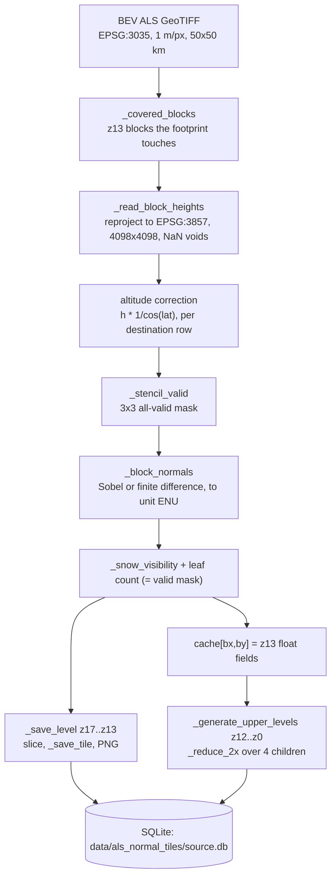
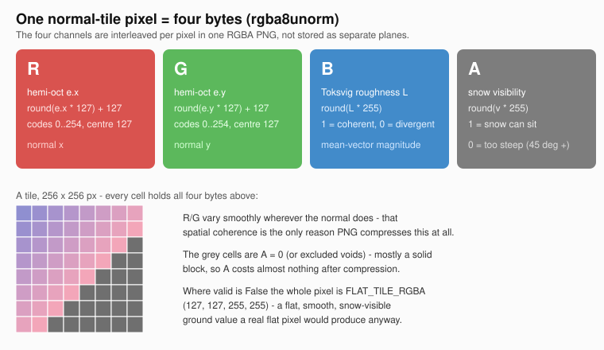
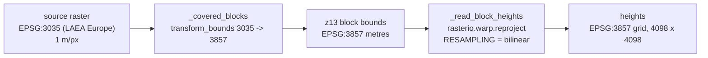
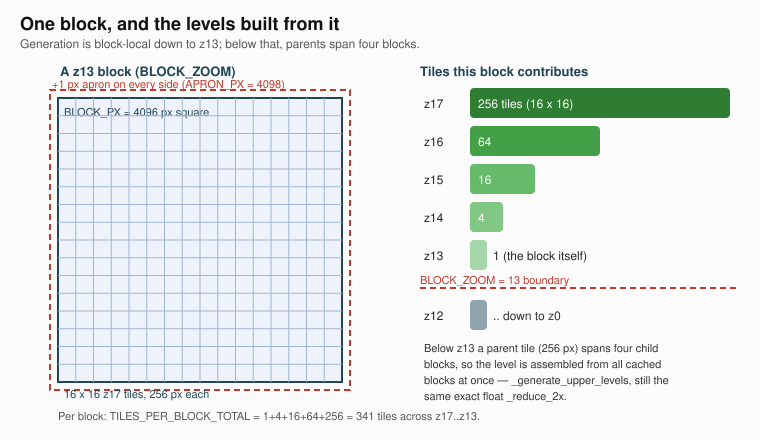
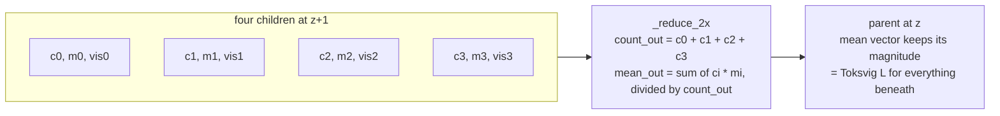
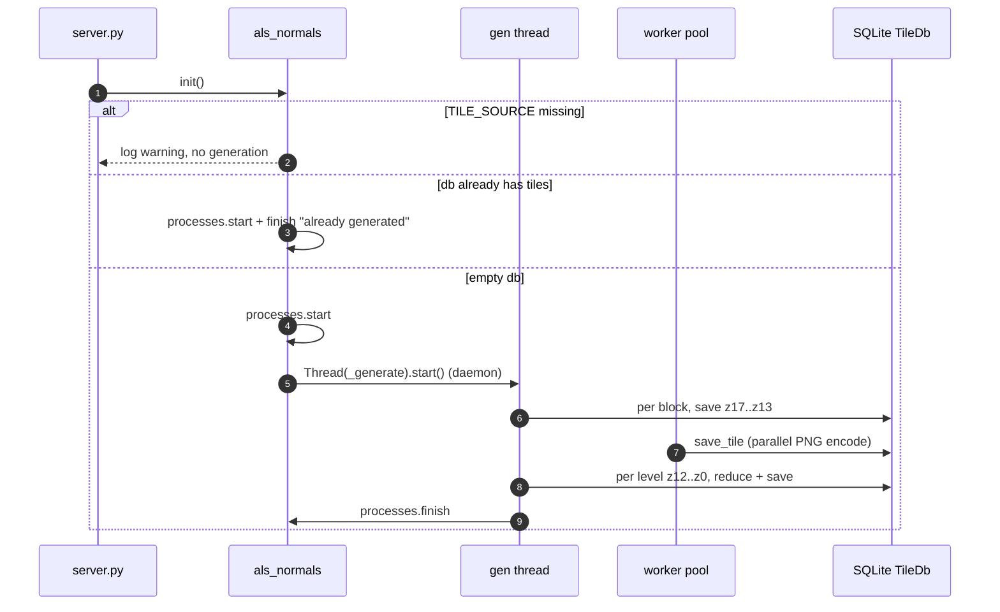

# ALS normal tiles — how the normal tile creator works

`tile_creators/als_normals.py` turns a single BEV ALS 1 m height raster (DTM or
DSM) into a slippy-map pyramid of surface-normal PNG tiles. This doc is the
*how* — the pipeline, the block layout, the float pyramid that backs it, and the
lifecycle of a generation run. Two companion docs own the parts this one builds
on instead of repeating:

- [`normal_map_encoding.md`](normal_map_encoding.md) — the byte format itself:
  R/G hemi-octahedral normal, B Toksvig roughness, A snow visibility, and the
  measurements behind 8 bits per channel.
- [`max_zoomlevel_normal_height_maps.md`](max_zoomlevel_normal_height_maps.md) —
  why the pyramid tops out at z17, and what z16 would save.

Reference implementation: [`tile_creators/als_normals.py`](../tile_creators/als_normals.py),
codec in [`util/encoding.py`](../util/encoding.py), cache in
[`util/tile_db.py`](../util/tile_db.py).

## At a glance

| | |
|---|---|
| **source** | one GeoTIFF in **EPSG:3035** (LAEA Europe), 1 m/px, 50×50 km — `TILE_SOURCE`, fetched by [`scripts/fetch_bev_als.py`](../scripts/fetch_bev_als.py) |
| **product** | DTM (bare earth) or DSM (surface) — the module never asks which; it processes whatever file `TILE_SOURCE` names |
| **output** | 256×256 RGBA8 PNG tiles, zoom **z0 … z17** |
| **cache** | SQLite at `DB_PATH`, one db file per source filename |
| **route** | `GET /v1/als-normals/{z}/{x}/{y}.png`, status at `/v1/als-normals/status` |
| **normals** | metric, **ENU** (+X east, +Y north, +Z up) — Web Mercator flattening is corrected *before* the normal is computed |

## Pipeline



Everything above `BLOCK_ZOOM` (z13) is done one block at a time and is entirely
block-local. Only below z13 does a parent tile span four blocks, and even there
the same exact float reduction is used — see
[The float-space pyramid](#7-the-float-space-pyramid).

## The output tile: one pixel, four bytes



The four channels are **interleaved** per pixel in a single RGBA PNG — this is
not a multi-band GeoTIFF. R/G carry the surface normal's hemi-octahedral
encoding, B the Toksvig roughness factor and A the snow-steepness visibility.
The encoding math and the reasons for each choice are in
[`normal_map_encoding.md`](normal_map_encoding.md); here it is enough that
`_encode_tile` is a thin wrapper over `util/encoding.py`'s `encode_tile`, which
"normalizes the mean vector exactly once, at the terminal write" (see below).

## Why the module ignores DTM vs DSM

Nothing in the code branches on the source product. `DB_PATH` is derived from
the *source filename*, so pointing `TILE_SOURCE` at the DTM and then at the DSM
of the same area produces two separate tilesets in two separate dbs — they can
never be silently interleaved into one file. That is the whole of the
"product" handling.

## Coordinate frames



| stage | frame | units |
|---|---|---|
| source raster | EPSG:3035 LAEA Europe | metres, 1 m/px |
| block / tile grid, heights | EPSG:3857 Web Mercator | metres |
| gradient sample spacing | `WEB_MERCATOR_RES_ZOOM0 / 2**MAX_ZOOM` (quad width) | 3857 metres |
| stored normal | **ENU, metric** | unit vector |

**Why reproject at all**, rather than a windowed read like `cosmos_snow.py`
uses: over a 50 km EPSG:3035 tile the 3035 → 3857 skew is far too large for an
axis-aligned window read to approximate, so each block is warped properly.

**The altitude correction.** Web Mercator inflates horizontal distances away
from the equator by `1/cos(lat)`. weBIGeo folds that into the *height* rather
than the quad size (AlpineMapsOrg/renderer#5), so `_read_block_heights` finishes
by multiplying each destination row by `1/cos(lat)` — computed per row from that
row's own latitude, not from one constant for the block. After this the raw Web
Mercator quad width can be used unchanged in the gradient and the result is
still the true metric normal.

## Blocks and the apron



Generation runs one **block** — a single z13 tile — at a time, reprojected once
at z17 resolution. A block is the unit that bounds peak memory, and it is also
the deepest level down to which the whole pyramid can be built from *one*
block's float data (every tile at z17…z13 lies entirely inside one block).

| constant | value | meaning |
|---|---|---|
| `MAX_ZOOM` | 17 | top of the pyramid (see the zoom companion doc) |
| `MIN_ZOOM` | 0 | bottom of the pyramid |
| `BLOCK_ZOOM` | 13 | block size / block-local pyramid floor |
| `TILE_SIZE` | 256 | px per tile |
| `TILES_PER_BLOCK_SIDE` | 16 | `2**(MAX_ZOOM - BLOCK_ZOOM)` |
| `BLOCK_PX` | 4096 | `TILES_PER_BLOCK_SIDE * TILE_SIZE` |
| `APRON` / `APRON_PX` | 1 / 4098 | extra destination pixel(s) around the block |
| `TILES_PER_BLOCK_TOTAL` | 341 | `1 + 4 + 16 + 64 + 256` tiles across z17…z13 |

**The apron** is one extra destination pixel around the block, so a gradient at
the very edge of the block has a real neighbour instead of an edge-clamped copy
of itself — that clamp is what would otherwise show up as a visible crease along
every block border. The apron pixels are consumed by the stencil and then
dropped (`_stencil_valid` returns the inner `BLOCK_PX × BLOCK_PX`).

Peak memory per block is the point of this design: a 4096² float32 height array
(~67 MB) plus its normal field (~200 MB), held only for one block at a time.

## Step by step

### 1. Which blocks to touch — `_covered_blocks`

The raster's own bounds are densified (`densify_pts=21`) and transformed into
EPSG:3857 to find the block index range, then each candidate block is checked
for real by transforming *its* bounds back into the source CRS and testing bbox
overlap. A 50 km EPSG:3035 tile is not axis-aligned in this grid, so the index
range necessarily includes corner blocks that hold no data; the bbox test
rejects most of them cheaply, and the per-tile validity mask catches the rest.

### 2. Reproject one block — `_read_block_heights`

`rasterio.warp.reproject` warps the source into the block's `APRON_PX × APRON_PX`
destination grid, initialized to **NaN**. NaN (not 0) for voids matters: a zero
would read as sea level and fabricate a cliff along every coverage border.
`SOURCE_NODATA` overrides the source's declared nodata when a BEV file carries
an undeclared sentinel. The warp is followed by the per-row Web Mercator
altitude correction described above.

### 3. Validity — `_stencil_valid`

A normal is only trusted where its **full 3×3 height stencil** was finite. A
void therefore never leaks a fabricated gradient into a real neighbouring pixel.

### 4. Gradient → ENU normal — `_block_normals`

The block is differentiated with either **Sobel** (default) or **finite
difference** (`NORMAL_METHOD`). Sobel blends the diagonal neighbours, which
suppresses part of the per-sample LiDAR noise — the point of baking normals at
source resolution rather than deriving them in the shader. The two methods
disagree by 0.77° mean on real alpine z17 data; that spread is the source's own
uncertainty and is what justifies 8-bit encoding.

```python
# Sobel: 3x3, diagonal-weighted. Slippy rows increase southward, so dzdy is
# already -dh/dy_north and enters un-negated; dzdx (eastward) is negated.
dzdx = (-(tl + 2*ml + bl) + (tr + 2*mr + br)) / 8.0 / quad_width
dzdy = (-(tl + 2*tm + tr) + (bl + 2*bm + br)) / 8.0 / quad_height
normal = stack([-dzdx, dzdy, 1])          # proportional to (-dh/dx, -dh/dy, 1)
```

The result is normalized to a unit vector, cast to float32, and **zeroed where
invalid**. That zero vector is harmless by construction — an invalid pixel also
carries leaf count 0, so it can never contribute to a parent average.

The frame convention (why `ny` looks asymmetric but is a consistent ENU normal)
is derived in [`normal_map_encoding.md`](normal_map_encoding.md#frame-convention).

### 5. Snow visibility and leaf count

At `MAX_ZOOM` every pixel is a single *exact leaf*: its mean vector is just
itself (magnitude 1, i.e. Toksvig `L = 1` — no roughness yet). Two quantities
are derived once, here:

- **`snow_vis = _snow_visibility(mean_vec)`** — `arctan2(hypot(nx, ny), nz)` in
  degrees, ramped to [0, 1] over `SNOW_ANGLE_MIN/MAX/BLEND` to mirror the
  weBIGeo shader's `calculate_band_falloff`. The angle uses `arctan2`, not
  `acos`, for the same conditioning reason [`normal_map_encoding.md`](normal_map_encoding.md)
  records for its angle measurements.
- **`count = valid`** as int64 — the number of valid z17 leaves under each
  pixel (1 or 0 at this level).

`mean_vec` is *not* renormalized after this point. Its magnitude from here on is
exactly the Toksvig roughness factor, and renormalizing early would discard it
before the terminal encode (see below).

### 6. Writing z17…z13 from the block — `_save_level` / `_save_tile`

`_generate_block` walks `z` from `MAX_ZOOM` down to `BLOCK_ZOOM`. At each level
it slices the current float fields into 256-px tiles (`per_side = shape //
TILE_SIZE`) and hands them to a thread pool, which encodes each slice to PNG and
saves it. `_save_tile` skips a tile whose `valid` mask is entirely false: an
all-flat tile there would be indistinguishable from real flat ground and would
bloat the db with the whole non-axis-aligned corner of every EPSG:3035 source
tile.

The block arrays are never mutated once the normals are computed, so workers
slice them concurrently with no lock; only `TileDb.save_tile` takes a lock.
After the z13 level, the block's float fields are returned to the caller and
cached (`cache[(bx, by)]`), and the caller `commit()`s the db per block.

### 7. The float-space pyramid

This is the one deliberate divergence from `cosmos_snow.py`. That module builds
a parent by re-decoding its four already-quantized children; doing that here
would re-quantize the normals once per zoom level and compound the error all the
way down. Instead the reduction runs on the **exact float mean-vector /
visibility / leaf-count fields**, block by block, and PNG encoding is only ever
a terminal write-out.



The weighting is by **leaf count**, not by an unweighted "how many of the 4
children were valid" tally. That shortcut looks natural but is inexact once
validity is non-uniform deeper in the tree: it lets a sparsely populated branch
outvote a densely populated one at their shared parent. Weighting by the exact
leaf count is exact by induction (a leaf has count 1 or 0 and mean equal to
itself; if every child is exact, `count_i * mean_i` is exactly that subtree's
leaf-vector sum). `count` is int64 because it reaches `4**(MAX_ZOOM-MIN_ZOOM)`,
already past uint32 at z16; the weighted products are computed in float64 for
the same reason. [`normal_map_encoding.md`](normal_map_encoding.md) carries the
worked counterexample.

`mean_vec` is **never renormalized** inside the reduction. Its magnitude after a
`_reduce_2x` call is exactly the Toksvig roughness factor for everything
underneath, and renormalizing early would discard it before the terminal encode.

**Below `BLOCK_ZOOM` — `_generate_upper_levels`.** Here a parent tile (256 px)
spans four child blocks, so the level is assembled from all cached blocks at
once: for each parent, the four children that exist are each reduced once and
placed into their half-resolution quadrant of a 256×256 field. A missing
quadrant (a block that held no data) stays at `count = 0`, so coverage edges
degrade to flat rather than to garbage and can never outvote a real quadrant.
This repeats from z12 down to z0. It is the same exact float reduction — only
the source of the arrays changed from "freshly warped" to "cached".

### 8. PNG encoding — `_encode_tile`

`_encode_tile` is a thin wrapper over `util/encoding.py`:

```python
rgba = encoding.encode_tile(mean_vec, snow_vis, valid=valid)
Image.fromarray(rgba, mode="RGBA").save(buf, format="PNG")
```

`encode_tile` is the **only** place a mean vector is normalized to a direction.
It normalizes to get R/G (hemi-octahedral projection, 127-centred 8-bit), writes
the clipped magnitude as B (Toksvig `L`), the snow visibility as A, and replaces
every `valid == False` pixel with `FLAT_TILE_RGBA`. The format, the 127-centring
and the reasons alpha carries real data are all in
[`normal_map_encoding.md`](normal_map_encoding.md).

## Lifecycle and concurrency



- `init()` is called from `server.py` at boot. It never blocks startup and never
  touches the network.
- Generation is **all-or-nothing per run, but resumable across restarts by
  skipping**: a block's lower levels come from its own float field, so there is
  nothing to resume a *partial* run from. Instead, if `DB_PATH` already holds any
  tile, the whole run is skipped. Restarting the server does not redo a completed
  tileset.
- Blocks are processed **sequentially**; the tiles *within* a level are written
  through a `ThreadPoolExecutor` of `GENERATION_WORKERS` (= `os.cpu_count()`),
  since the work is CPU-bound (numpy slicing + PNG encode) with no network I/O.
- `COMMIT_BATCH_SIZE` bounds what an ungraceful crash can lose, and `_generate`
  force-commits partial progress before reporting a failure via `processes.fail`.
- Progress is reported through `processes.py` (the same registry the landing page
  polls), not by logging per tile.

## Serving

Two routes in [`routes_v1.py`](../routes_v1.py):

- `GET /v1/als-normals/status` → `{status, source, bounds, min_zoom, max_zoom}`.
  `status` is one of `generating` / `ready` / `error`. The WGS84 `bounds`
  (densified, since the EPSG:3035 footprint's edges curve in EPSG:4326) and
  `max_zoom` let a client jump to the coverage and set `maxNativeZoom` — a
  single 50 km footprint is a small target on a world map.
- `GET /v1/als-normals/{z}/{x}/{y}.png` → the tile as `image/png`. It serves
  whatever is in the db **right now**, so a partially built tileset is viewable
  while it builds. A missing tile returns `503` while generation is still
  running, and `404` once ready (which is the normal case for the
  non-axis-aligned corners of a 3035 source tile, not an error).

[`docs/map.html`](map.html) consumes the tileset with a hand-written PNG
decoder (`decodePngRGBA`), because browsers premultiply RGB by alpha and A is
real data here. It offers raw RGBA, a per-channel view (R/G/B/A isolated as
grayscale) and a decoded view, which makes the storage form inspectable instead
of hidden behind a shader. The layer starts inactive — its coverage is elsewhere
in Austria — and the "zoom to coverage" button enables it with the jump.

## Tunables

All of these are module constants at the top of `als_normals.py`, not entries in
`config.py` — they are implementation details of this one tile source, not
deployment config (see `CLAUDE.md`).

| constant | default | effect |
|---|---|---|
| `TILE_SOURCE` | a BEV DSM GeoTIFF | the single raster to process |
| `TILES_DIR` / `DB_PATH` | `data/als_normal_tiles/` | db is named after the source file |
| `MAX_ZOOM` / `MIN_ZOOM` | 17 / 0 | vertical extent of the pyramid |
| `BLOCK_ZOOM` | 13 | block size and block-local pyramid floor |
| `APRON` | 1 | destination px of context around a block |
| `NORMAL_METHOD` | `"sobel"` | `"sobel"` or `"finite_difference"` |
| `RESAMPLING` | `bilinear` | warp resampling; must become `average` if `MAX_ZOOM` drops to ~z16 |
| `SNOW_ANGLE_MIN/MAX/BLEND` | 0 / 45 / 5 | degrees; baked into A, mirrors the shader |
| `SOURCE_NODATA` | `None` | override an undeclared source sentinel |
| `COMMIT_BATCH_SIZE` | 500 | tiles saved between SQLite commits |
| `GENERATION_WORKERS` | `os.cpu_count()` | PNG-encode worker threads |

## Notes and limitations

- **There is no versioning or per-tile resume.** Anything that changes the
  written bytes — `NORMAL_METHOD`, `RESAMPLING`, `SNOW_ANGLE_*`, `MAX_ZOOM`,
  an encoding change in `util/encoding.py` — requires deleting `DB_PATH` and
  regenerating; otherwise `has_tiles()` skips the run and stale tiles are served.
- **`MAX_ZOOM` and `RESAMPLING` move together.** z17 oversamples the 1 m source,
  so `bilinear` is right. At z16 the warp becomes a *downsample* and
  `RESAMPLING` should become `Resampling.average`, or the extra source samples
  are point-sampled past rather than averaged away. See
  [`max_zoomlevel_normal_height_maps.md`](max_zoomlevel_normal_height_maps.md).
- **Peak memory scales with `BLOCK_ZOOM`.** Lowering it costs proportionally
  more reprojection calls with more apron overlap; raising it grows the per-block
  height and normal arrays.

## See also

- [`normal_map_encoding.md`](normal_map_encoding.md) — the RGBA byte format.
- [`max_zoomlevel_normal_height_maps.md`](max_zoomlevel_normal_height_maps.md) —
  zoom/resolution trade-off.
- [`scripts/normal_map_playground.ipynb`](../scripts/normal_map_playground.ipynb) —
  where the encoding numbers were measured.
- [`util/encoding.py`](../util/encoding.py) — `encode_tile` / `decode_tile`, the
  single source of truth for the format.


